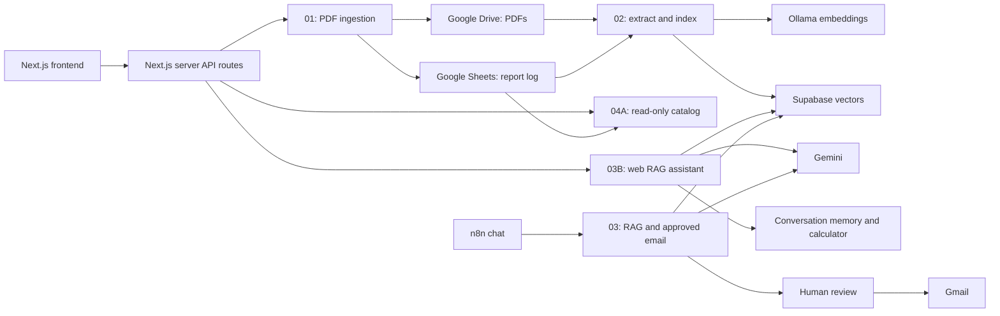

# NileMart — AI-Powered Retail Intelligence & Automation Platform

NileMart connects monthly retail reports to a searchable document library and an AI assistant. A Next.js frontend works with five n8n workflows to validate PDFs, archive them in Google Drive, log report metadata in Google Sheets, index their content in Supabase, and answer questions using Gemini and Ollama embeddings.

This is a completed **local-development demonstration using synthetic retail data**, built around a fictional retailer with branches in Cairo, Alexandria, Giza, and Mansoura. It is not publicly deployed. Imported workflows need your own credentials and resources; the exact Supabase SQL definitions and source n8n version remain configuration gaps documented in the [backend setup guide](docs/BACKEND_SETUP.md).

## Business problem

Monthly sales and inventory PDFs are useful records, but managers must find the correct branch and period, reconcile repeated uploads, and read multiple documents to answer routine questions. Upload failures and incomplete retrieval can also produce misleading conclusions if they are treated as successful processing.

## Solution

NileMart separates document intake, indexing, metadata browsing, and AI retrieval. Each stage has an explicit responsibility and error path. The frontend gives users a single place to upload, browse, and ask questions, while service credentials remain behind server boundaries.

## Key features

- **Dashboard:** consistent navigation and accurate feature availability labels, separate from live service health.
- **PDF upload:** client and server validation, Drive storage, Sheets logging, duplicate rejection, and explicit partial-failure handling.
- **Document indexing:** PDF text extraction, metadata normalization, recursive chunking, Ollama embeddings, and Supabase storage.
- **Sales Reports:** dynamic catalog summaries, filename/branch/month search, filters, deterministic sorting, multiple-upload badges, and individual Drive links.
- **Web AI Assistant:** report-grounded questions, conversation memory, calculator access, source-aware prompts, and Markdown responses.
- **Approved email summaries:** a separate n8n chat workflow routes Gmail actions through human review.
- **Recovery:** sanitized API errors, bounded requests, timeouts, explicit retry behavior, and no automatic retry of uncertain uploads.

The catalog preserves every valid record returned by its API. A repeated branch/month identifies multiple uploads; it does not establish identical PDF contents. The ingestion workflow rejects new duplicate branch/month submissions, while the catalog can still show historical duplicates.

## System architecture



See [architecture and security boundaries](docs/ARCHITECTURE.md) for the complete data flow.

## Technologies

| Layer | Technology |
| --- | --- |
| Frontend | Next.js 16.4.3, React 19.3.1, TypeScript 5.9.3, Tailwind CSS 4.3.3 |
| Automation | n8n workflows, webhooks, service nodes, and JavaScript Code nodes |
| Documents and metadata | Google Drive and Google Sheets |
| Vector retrieval | Supabase, with a referenced `documents` table and `match_documents` function |
| Embeddings | Ollama, exported model `nomic-embed-text:latest` |
| Language model | Gemini; exports select `models/gemini-3.5-flash-lite` |
| AI orchestration | n8n AI Agent, memory, calculator, retrieval tools, and human approval |
| Verification | Node test runner, React server rendering, ESLint, TypeScript, Next.js build |

Model names describe the supplied exports, not a promise of current provider availability. Use the same verified embedding model for ingestion and retrieval.

## n8n workflows

| Export | Purpose |
| --- | --- |
| [01 — Monthly Sales Ingestion](workflows/01_Monthly_Sales_Ingestion.json) | Validate multipart uploads, reject duplicates, archive PDFs, and log metadata |
| [02 — Document Processing](workflows/02_Document_Processing.json) | Extract PDF text, normalize metadata, skip previously indexed file IDs, and store embeddings |
| [03 — AI Assistant RAG & Gmail](workflows/03_AI_Assistant_RAG_Gmail.json) | n8n chat with retrieval, arithmetic, memory, and human-approved Gmail |
| [03B — Web AI Assistant](workflows/03B_Web_AI_Assistant.json) | Basic-authenticated chat endpoint for the Next.js assistant |
| [04A — Reports Catalog API](workflows/04A_Reports_Catalog_API.json) | Basic-authenticated, read-only report metadata endpoint |

All public exports are **inactive**, have no assigned credentials, and use placeholders for Google resources. Importing them does not configure or activate an integration. The [workflow guide](workflows/README.md) documents credentials, inputs, outputs, and configuration.

## Frontend application

| Route | Behavior |
| --- | --- |
| `/` | Dashboard |
| `/upload-report` | PDF upload form |
| `/sales-reports` | Read-only catalog and filtering |
| `/ai-assistant` | Report questions and conversation history |
| `POST /api/reports/upload` | Validated multipart proxy to Workflow 01 |
| `POST /api/chat` | Server-side chat proxy to Workflow 03B |
| `GET /api/reports` | Validated, uncached metadata proxy to Workflow 04A |

Browser requests use same-origin Next.js endpoints. They do not carry n8n Basic Auth credentials. PDF actions deliberately open validated Google Drive links in a new tab.

## AI and RAG architecture

Workflow 02 extracts text, prepares branch/month/file metadata, and splits documents into 1,800-character chunks with 250-character overlap. Ollama generates embeddings for Supabase. Workflows 03 and 03B query the same vector store, use Gemini to compose answers, and provide calculator and conversation-memory tools.

Prompts require source retrieval before report-dependent answers and explicit disclosure of incomplete coverage. Similarity search can still omit documents; a retrieved top-K set is not a complete report inventory. The calculator improves arithmetic only when its source inputs are complete.

The web workflow has **no connected Gmail tool**. Its inherited prompt still mentions email, but Gmail actions exist only in Workflow 03. This preparation preserves that source behavior and documents the discrepancy.

## Setup requirements

- Node.js **24** and npm for the documented frontend/test commands. The package's broader engine range does not guarantee support for the strip-types test runner on older Node releases.
- A compatible local n8n installation with the exported node versions.
- Google Drive/Sheets credentials; Gmail credentials only for Workflow 03.
- Supabase with the owner's verified schema and retrieval function.
- Ollama with the exported embedding model and an accessible local service.
- A Gemini API credential with access to the configured model.

Dependencies are locked in [frontend/package-lock.json](frontend/package-lock.json). The source n8n application version and exact database DDL were not supplied; see [missing configuration information](docs/BACKEND_SETUP.md#missing-configuration-information).

## Local installation

From the repository root:

```powershell
cd frontend
npm.cmd ci
if (-not (Test-Path .env.local)) {
  Copy-Item .env.example .env.local
}
npm.cmd run dev -- --hostname 127.0.0.1
```

Open **http://localhost:3000**. On shells other than PowerShell, use `npm` instead of `npm.cmd`. Preserve an existing local environment file. A running backend is needed for service requests; automated frontend tests use mocks.

## Environment configuration

[frontend/.env.example](frontend/.env.example) is the configuration reference. Fill your own values in the ignored `frontend/.env.local`; never prefix credentials with `NEXT_PUBLIC_`.

| Variables | Purpose |
| --- | --- |
| `N8N_UPLOAD_WEBHOOK_URL` | Workflow 01 production upload URL |
| `N8N_CHAT_WEBHOOK_URL`, `N8N_CHAT_USERNAME`, `N8N_CHAT_PASSWORD` | Workflow 03B production chat URL and Basic Auth |
| `N8N_REPORTS_WEBHOOK_URL`, `N8N_REPORTS_USERNAME`, `N8N_REPORTS_PASSWORD` | Workflow 04A production catalog URL and Basic Auth |
| `APP_ORIGIN` | Exact browser origin, normally `http://localhost:3000` |
| `UPLOAD_MAX_BYTES`, `UPLOAD_TIMEOUT_MS` | Upload size and upstream deadline |

Google, Supabase, Ollama, and Gemini credentials are configured in n8n, not in browser code or this frontend template. Restart Next.js after environment changes.

## Workflow import instructions

1. Follow [backend setup](docs/BACKEND_SETUP.md) using isolated resources you control.
2. Import only the five numbered public exports listed above.
3. Assign your own credentials and replace every resource placeholder using the [configuration map](workflows/README.md#configuration-map).
4. Resolve the missing Supabase definitions before indexing or retrieval.
5. Check each node and error branch before enabling triggers. Obtain production webhook URLs from your own n8n editor.
6. Validate with the [reviewed synthetic samples](sample-data/README.md). Do not send email without an explicit recipient and approval.

Legacy raw exports may remain in a local working directory, but are explicitly ignored. Do not publish a ZIP of the whole working directory or force-add ignored files.

## Testing and validation

From `frontend/`:

```powershell
npm.cmd test
npm.cmd run lint
npm.cmd run typecheck
npm.cmd run build
```

From the repository root:

```powershell
node scripts/validate-portfolio.mjs
```

The frontend suite covers validation, transport boundaries, upstream failures, rendered content, catalog grouping/filtering, and Dashboard status. The portfolio validator checks workflow structure and JavaScript syntax, sample reconciliation, and local documentation links without calling external services.

See [validation records](docs/VALIDATION.md) for dated results and their limits. Static workflow validation does not establish a successful n8n import or live execution.

## Screenshots and demo

Verified application screenshots have not been supplied. These are explicit documentation placeholders, not image links:

| View | Status |
| --- | --- |
| Dashboard | Pending verified screenshot |
| Sales Reports | Pending screenshot with synthetic records |
| Upload Report | Pending form and outcome screenshots |
| AI Assistant | Pending sourced synthetic-data conversation screenshot |
| n8n workflow architecture | Pending credential-free canvas screenshots; diagram above is documentation |

Capture guidance is in [docs/screenshots/README.md](docs/screenshots/README.md).

**Demo video:** pending recording and final link. No demo URL is available. A suitable recording shows upload, indexing, catalog browsing, and a sourced question; optionally show the separate email approval flow using a controlled recipient.

## Repository layout

```text
frontend/          Application, configuration, and automated tests
workflows/         Five sanitized exports and configuration guide
docs/              Architecture, setup, API guides, validation, review notes
docs/screenshots/  Screenshot checklist; verified images pending
sample-data/       Two sample PDFs, CSV references, scoped expected answers
scripts/           Offline portfolio validation
```

## Limitations

- Local-development application: no end-user authentication, report authorization, or rate limiting. Publication of source code does not make it suitable for public hosting.
- Upload confirmation covers Drive/Sheets, not completed indexing. Partial uploads require manual reconciliation; duplicate lookup is not a concurrency-safe idempotency guarantee.
- PDF processing requires extractable text; OCR is not implemented.
- Indexing skips a file ID when any existing chunk is found, so an interrupted partial index may require deliberate recovery.
- Multiple uploads can represent different source contents. Retrieval must not assume one authoritative PDF solely from a branch/month match.
- Browser chat history is per-tab session storage; n8n memory has a separate lifecycle.
- Exact Supabase DDL, vector dimensions, retrieval-function definition, source n8n version, screenshots, and video remain documented handoff items.
- No performance improvements or accuracy percentages are claimed. No license has been selected or added.

See the [publication review](docs/PUBLICATION_REVIEW.md) for preparation scope and remaining checks.
