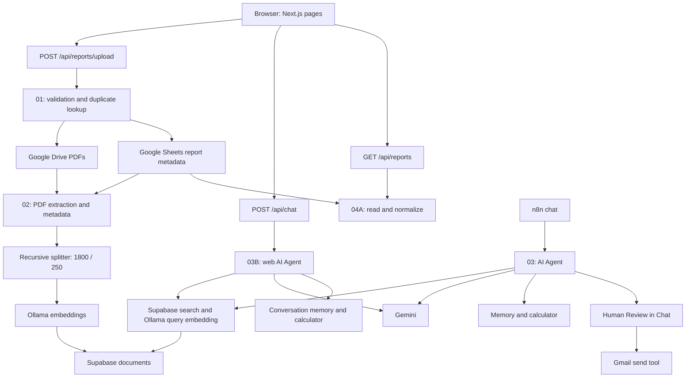

# NileMart system architecture

The application combines a Next.js frontend with five independent n8n workflows. This document describes the supplied current exports and existing source code. Feature availability does not imply current service health.

## Components and ownership

| Component | Responsibility |
| --- | --- |
| Next.js | Dashboard, upload form, catalog, chat, and server-side API boundary |
| n8n 01 | Validate PDF/metadata, check duplicates, upload to Drive, append a Sheets record |
| Google Drive | Original PDF archive; file-created events trigger indexing |
| Google Sheets | Report metadata log used by ingestion, indexing, and catalog |
| n8n 02 | Extract text, prepare metadata, check existing chunks, split and embed documents |
| Ollama | Embeddings for ingestion and retrieval |
| Supabase | Vector storage and retrieval; exact SQL schema is not included |
| n8n 03 | n8n-native chat with RAG, memory, calculator, and approved Gmail actions |
| n8n 03B | Basic-authenticated web chat with RAG, memory, and calculator |
| Gemini | Agent language model |
| n8n 04A | Read-only metadata catalog |
| Gmail | Send a requested summary after human review in Workflow 03 |

## Data movement

Arrows show dependencies and data movement, not a guarantee of transactional ordering. Drive storage and Sheets logging can succeed or fail separately; indexing runs asynchronously.

## Frontend-to-n8n API boundaries

| Browser endpoint | Upstream workflow | Boundary |
| --- | --- | --- |
| POST `/api/reports/upload` | 01, POST production webhook | Multipart PDF, branch, and month; validation, origin checks, limits, sanitized outcomes |
| POST `/api/chat` | 03B production Chat URL | Browser message/session mapped to n8n chatInput/sessionId; Basic Auth only on server |
| GET `/api/reports` | 04A, GET production webhook | Server Basic Auth; validated metadata; no-store caching; bounded response and timeout |

The route files import `server-only`. Environment variables are read there and passed to independently testable handlers. The browser never chooses an upstream URL or receives an authentication header.

The metadata catalog does not provide financial totals, indexing state, or PDF summaries. The Sales Reports page computes only metadata statistics. It preserves all returned records and marks every member of a normalized branch/month group as a multiple upload.

Validated Drive PDF links open in a separate tab. Google Drive permissions remain independent of the local application.

## PDF ingestion and indexing

1. Workflow 01 checks the multipart file, PDF MIME/extension/signature, allowed branch, and YYYY-MM month.
2. It looks up branch/month metadata in Sheets. A duplicate returns 409 before upload; lookup failure stops intake.
3. It stores the PDF and appends six columns: `branch`, `report_month`, `file_name`, `uploaded_at`, `drive_file_id`, `file_link`.
4. Drive's file-created event reaches Workflow 02. A PDF guard precedes download and text extraction.
5. Metadata comes from Sheets when available, with branch/month fallback from filename or extracted text. Empty/short text is rejected; scanned files may require OCR.
6. The workflow checks `documents` for `metadata->>file_id`. A found chunk skips that file ID.
7. New text is split into 1,800-character chunks with 250 overlap, embedded with `nomic-embed-text:latest`, and inserted into Supabase.

The data loader attaches file ID/name, branch, month, Drive URL, source, indexing time, metadata source, and page count. The repository does not include the exact database DDL, vector dimension, indexes, permissions, or `match_documents` SQL. These must be obtained from the owner; no replacement schema has been invented.

## AI assistant behavior

Both agents use a Gemini model, Supabase retrieval tool, Ollama embeddings, conversation memory, and calculator. Workflow 03B's export sets topK to 40, memory context length to 8, and maximum agent iterations to 8. These settings describe configuration, not measured accuracy or completeness.

Prompts require report retrieval, consistent KPI definitions, source attribution, and explicit acknowledgement of missing data. Retrieved documents are treated as untrusted data. Similarity search does not prove that every relevant report was retrieved.

Workflow 03 routes the Gmail tool through a Human Review tool. Workflow 03B contains no Gmail or approval node, despite inherited email wording in its prompt. The web frontend therefore does not implement email sending. Original prompts and wiring were preserved during sanitization.

Browser history stores up to 100 recent messages and its session ID in sessionStorage. New Chat creates a new session; it does not delete n8n-side memory. This is not user authentication or durable archival storage.

## Security boundaries and recovery

- n8n owns Google, Supabase, Gemini, and Ollama credentials. Next.js owns only upstream URLs, chat/catalog Basic Auth, and upload settings.
- Same-origin checks reduce browser misuse; they are not an authentication system. The local application has no end-user authorization or rate limiting.
- Upstream errors are mapped to safe frontend responses; credentials and raw diagnostics are not returned.
- Uploads have no automatic retry. A missing response or Sheets failure may follow a successful Drive write and requires resource reconciliation.
- Catalog refresh is read-only. It never edits Sheets, deletes files, or merges uploads.
- Public exports contain no credential assignments, no pinned execution data, and no instance metadata. They are inactive and require explicit reconfiguration.
- Workflow 01's source export has no webhook authentication configured. It must remain in a controlled local environment; this preparation does not change its access model.
- Model-generated answers can be incomplete or wrong. Validate against source reports and the synthetic reference data.

## Export provenance and validation limits

The five files in [workflows](../workflows/README.md) were prepared from the user-supplied current-export directory. The first three matched the older public candidates byte-for-byte before sanitization. Node names, types, versions, connections, JavaScript, expressions, prompts, and error behavior were retained.

Only credentials, resource selectors, cache metadata, instance identifiers, activation state, and execution data were sanitized. Static checks establish structural consistency, not a successful import into a particular n8n version. No live services were modified or executed during portfolio preparation.

See [backend setup](BACKEND_SETUP.md), [validation](VALIDATION.md), and [publication review](PUBLICATION_REVIEW.md).
